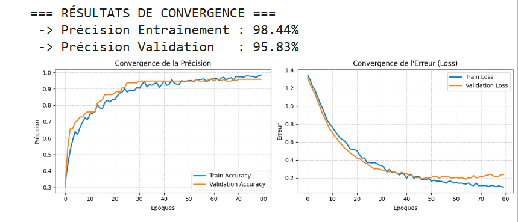

# Reconnaissance de gestes sur STM32L475 — Du capteur à l'IA embarquée

**STM32L475 · C embarqué · LSM6DSL / I²C · Acquisition et traitement du signal · TensorFlow · X-CUBE-AI · UART · Python**

## Pourquoi ce projet ?

L'idée était de créer une **interface capable de reconnaître un mouvement de la main sans envoyer les mesures à un service distant**. Pour cela, il fallait résoudre plusieurs problèmes : enregistrer un mouvement avec un capteur inertiel, transformer cette série de mesures en données exploitables, entraîner un classifieur puis faire fonctionner la prédiction directement sur un microcontrôleur.

Le résultat est un **prototype de reconnaissance de gestes dynamiques** : la carte STM32 distingue les lettres **L, O et Z** et une quatrième catégorie **BRUIT**. **L'acquisition et l'inférence se déroulent sur le STM32** ; l'ordinateur affiche simplement la classe reconnue et le score de sortie du réseau.

Ce projet associe du **développement firmware en C** (pilote I²C, acquisition, buffers, UART), du **traitement de signaux inertiels**, de l'**apprentissage automatique** (TensorFlow/Keras), de l'**intégration TinyML** (X-CUBE-AI) et une **interface Python**.

**[▶ Voir la vidéo de démonstration](https://raw.githubusercontent.com/DIALLOAmadouOury/STM32-gesture-recognition/main/assets/video_demo.mp4)** · **[Explorer le firmware C](stm32_firmware/Core/Src/)** · **[Consulter le notebook d'entraînement](model_training/Copie%20de%20gesture_ML.ipynb)**

## Comment fonctionne la reconnaissance ?

L'utilisateur **appuie sur le bouton de la carte**, puis trace un geste dans l'espace. Le capteur **LSM6DSL** mesure les accélérations selon trois axes. Le firmware constitue une fenêtre de **100 triplets X/Y/Z** en visant un intervalle de **20 ms entre lectures**, soit environ **deux secondes** de mouvement.

Ces **300 valeurs** sont normalisées en C et transmises à un petit réseau de neurones intégré au STM32. Le programme choisit la classe dont le score de sortie est le plus élevé, puis envoie la prédiction à l'ordinateur par **UART**. L'application **Tkinter/PySerial** affiche alors le geste reconnu et son score.

L'objectif technique est de relier **mesure physique, préparation des données, modèle IA et application embarquée**, sans confier la classification au PC.

## Architecture et caractéristiques du prototype

| Cible | Acquisition | Modèle | Calcul embarqué |
| :--- | :--- | :--- | :--- |
| **STM32L475**, Cortex-M4 80 MHz | **100 mesures × 3 axes** sur ~2 s, cadence visée **50 Hz** | **300 → 16 → 8 → 4**, 4 classes | **5 072 MACC** indiqués par le code généré X-CUBE-AI |

**Chaîne fonctionnelle**

```text
Mouvement de la main
        ↓
LSM6DSL (accéléromètre 3 axes, ±2 g)
        ↓  I²C2
STM32 — acquisition de 100 triplets (X, Y, Z)
        ↓
Normalisation en C / 2.0 et vecteur de 300 valeurs
        ↓
Réseau MLP embarqué avec X-CUBE-AI → BRUIT / L / O / Z
        ↓  UART1 — 115 200 bauds
Application Python / Tkinter : geste prédit + score
```

## Ce que j'ai développé et intégré

| Domaine | Réalisation concrète |
| --- | --- |
| **Driver de capteur / communication I²C** | [`lsm6dsl.c`](stm32_firmware/Core/Src/lsm6dsl.c) : accès aux registres `WHO_AM_I`, `CTRL1_XL`, lecture des six octets d'accélération et conversion des valeurs signées 16 bits en `g` |
| **Acquisition et traitement en C** | [`gesture_ia.c`](stm32_firmware/Core/Src/gesture_ia.c) : déclenchement par **GPIO PC13**, fenêtre de **100 mesures sur 3 axes**, cadence visée de **20 ms**, normalisation et remplissage d'un tenseur de **300 Float32** |
| **Intégration d'un modèle dans le firmware** | [`gesture_ia.c`](stm32_firmware/Core/Src/gesture_ia.c) : initialisation du runtime X-CUBE-AI, buffer d'activation statique aligné sur **32 octets**, appel à `ai_network_run()` et sélection de la classe de score maximal |
| **Communication UART** | [`main.c`](stm32_firmware/Core/Src/main.c) et [`gesture_ia.c`](stm32_firmware/Core/Src/gesture_ia.c) : **UART1 à 115 200 bauds**, redirection de `printf` et messages `START`, `END_ACQ`, `RES:CLASSE:SCORE` |
| **Intégration applicative STM32** | [`main.c`](stm32_firmware/Core/Src/main.c) : initialisation HAL, I²C2, USART1, GPIO et boucle principale appelant `Gesture_Task()` |
| **Outil de supervision** | [`gui_dashboard.py`](pc_scripts/gui_dashboard.py) : lecture série PySerial et interface Tkinter — **côté PC**, distinct du firmware C |

**L'enjeu d'intégration :** relier acquisition et traitement du signal en C, prétraitement cohérent avec l'entraînement Python, gestion des buffers d'inférence, puis affichage sur PC sans y déporter la classification.

Ici, la logique utilise une **boucle principale et des attentes basées sur `HAL_GetTick()`**, pas FreeRTOS. L'intervalle de 20 ms est une **cible logicielle** et non une cadence vérifiée à l'oscilloscope.

## Choix d'implémentation et détails techniques

### 1. Acquisition inertielle et échantillonnage en C

Le pilote [`lsm6dsl.c`](stm32_firmware/Core/Src/lsm6dsl.c) communique avec le capteur par **I²C** : lecture de l'identifiant `WHO_AM_I`, configuration de l'accéléromètre à **±2 g / 104 Hz**, lecture des six octets des axes X/Y/Z et conversion des valeurs signées 16 bits en accélération exprimée en `g`.

Dans [`gesture_ia.c`](stm32_firmware/Core/Src/gesture_ia.c), une pression sur le bouton **PC13** déclenche l'acquisition. Pour chaque geste, le STM32 recueille **100 triplets** en visant un intervalle de **20 ms**, à l'aide de `HAL_GetTick()`.

**Point d'ingénierie :** construire un vecteur de caractéristiques de taille fixe à partir de mesures physiques. La cadence de lecture de l'application (visée à 50 Hz) est distincte de la fréquence de sortie configurée sur le capteur (104 Hz).

### 2. Prétraitement et inférence directement sur STM32

Chaque triplet est normalisé dans le firmware avant d'être placé dans le tenseur d'entrée :

```c
ai_in_data[i * 3 + 0] = (ai_float)(x / 2.0f);
ai_in_data[i * 3 + 1] = (ai_float)(y / 2.0f);
ai_in_data[i * 3 + 2] = (ai_float)(z / 2.0f);
```

Le réseau dense entraîné sous **TensorFlow/Keras** possède deux couches cachées de **16 et 8 neurones**, puis une sortie **softmax à quatre classes**.

L'intégration C utilise **STM32 X-CUBE-AI** avec initialisation du réseau, poids générés, tampons d'entrée/sortie et buffer d'activation statique **aligné sur 32 octets**. Le code produit par X-CUBE-AI indique **5 072 MACC** pour le modèle, sans que cela constitue une mesure de latence.

- [Implémentation de l'inférence](stm32_firmware/Core/Src/gesture_ia.c)
- [Réseau C généré par X-CUBE-AI](stm32_firmware/X-CUBE-AI/App/network.c)
- [Modèle TensorFlow Lite exporté](model_training/gesture_model_quantized.tflite)

Le notebook applique une optimisation TensorFlow Lite et exporte un fichier d'environ **8,6 Kio**. Le réseau C actuellement publié utilise des **poids et des E/S Float32** : il ne s'agit pas d'une preuve d'exécution entièrement INT8 sur STM32.

### 3. Communication STM32 → Python

Après l'inférence, le firmware récupère la classe de score maximal et envoie un message série structuré :

```text
START
END_ACQ
RES:Z:92.50
```

Le protocole repose sur **UART1 à 115 200 bauds**. L'application [`gui_dashboard.py`](pc_scripts/gui_dashboard.py) lit ces messages avec **PySerial**, dans un fil de lecture séparé, et affiche avec **Tkinter** le geste reconnu, son score et l'état de l'acquisition.

Cette séparation permet de conserver **la collecte et la décision sur la carte** tout en disposant d'un affichage plus lisible sur ordinateur.

## Entraînement et expérimentation

Le [notebook Jupyter](model_training/Copie%20de%20gesture_ML.ipynb) documente la préparation des signaux, l'entraînement du MLP, l'augmentation des données par ajout de bruit et l'export TFLite.

| Données de l'exécution enregistrée | Valeur |
| --- | ---: |
| Classes | BRUIT, L, O, Z |
| Enregistrements d'origine chargés | **120** — 30 par classe |
| Mesures par enregistrement | **100 × 3 axes** |
| Paramètres du réseau | **4 988** |
| Taille du fichier TFLite exporté | **environ 8,6 Kio** |



*Courbes de l'expérience d'entraînement publiée. Le notebook affiche 95,83 % de précision de validation, mais ce score reste indicatif : les signaux ont été augmentés **avant** la séparation entraînement/validation, ce qui peut introduire des variantes d'un même geste dans les deux ensembles. Une validation fiable demandera de séparer les enregistrements originaux avant augmentation et d'utiliser une session de test indépendante.*

L'archive des acquisitions brutes `data.zip`, utilisée dans le notebook, n'est pas encore publiée.

## Démonstration et lancement de l'interface

**[▶ Regarder la démonstration vidéo (MP4)](https://raw.githubusercontent.com/DIALLOAmadouOury/STM32-gesture-recognition/main/assets/video_demo.mp4)**

Ce lien ouvre le fichier vidéo directement, plutôt que sa page de code GitHub. Selon le navigateur, la lecture peut démarrer dans un lecteur vidéo ou le fichier peut être téléchargé.

Pour lancer l'interface de visualisation sur un PC connecté à la carte :

```bash
python -m pip install pyserial
python pc_scripts/gui_dashboard.py
```

Adapter le port `PORT_COM` dans le script à celui de la carte (`COM4` dans la version publiée). L'interface s'attend aux messages `START` et `RES:CLASSE:SCORE` du firmware.

Le dépôt contient également [`dashboard_ia.py`](pc_scripts/dashboard_ia.py), une autre interface de visualisation des accélérations. Son format de messages UART est différent et elle n'est pas directement compatible avec le firmware d'inférence publié.

## Organisation du dépôt

| Dossier | Contenu |
| --- | --- |
| [`stm32_firmware/Core/`](stm32_firmware/Core/) | Acquisition I²C, pilote LSM6DSL, gestion du bouton et inférence en C |
| [`stm32_firmware/X-CUBE-AI/`](stm32_firmware/X-CUBE-AI/) | Sources du réseau générées par X-CUBE-AI |
| [`model_training/`](model_training/) | Notebook d'entraînement et modèle TFLite |
| [`pc_scripts/`](pc_scripts/) | Interface de supervision série en Python |
| [`assets/`](assets/) | Vidéo de démonstration et illustrations |

**État du projet.** Les principaux modules applicatifs sont publiés, mais pas l'ensemble des fichiers de configuration et dépendances permettant de reconstruire directement un projet STM32CubeIDE autonome. Pour une reproduction complète, il reste à fournir le projet CubeIDE, les données d'entraînement d'origine et des mesures de temps d'inférence/occupation mémoire sur cible.

---

**Amadou Oury Diallo** — Projet personnel en systèmes embarqués, acquisition inertielle et TinyML.
